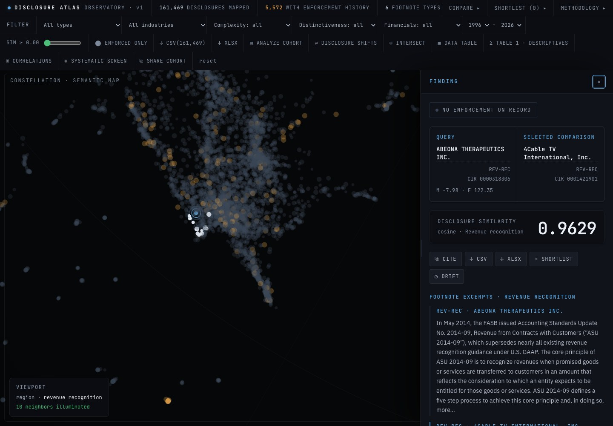

# Disclosure Atlas

**Explore the language of public-company disclosures. Reproduce the research behind it.**

Disclosure Atlas combines semantic search over **161,469 SEC disclosure excerpts from
3,253 companies** with an empirical study of disclosure language and financial screens.
The browser application connects each comparison to its source filing and supports
company-year panels, descriptive statistics and a fully reported multiple-testing screen.

[**Read the paper**](paper/disclosure_atlas_paper.pdf) ·
[**Explore the app**](https://disclosure-atlas.vercel.app) ·
[**Reproduce a result**](examples/README.md) ·
[Research page](https://simplydose.app/disclosure-atlas/)

[October 25 research note](paper/RESEARCH_NOTE_2026-10-25.md) clarifies the archived
paper's interpretation, measure construction and scope of reproducibility.



## Research question

How are disclosure readability and linguistic distinctiveness related to financial-screen
measures among companies with going-concern language?

The paper examines **4,186 company-years from 1,373 companies**, selected by extracted
going-concern language. Estimated correlations
between the two language measures and the composite Beneish M-Score and Dechow F-Score
are small. None of those composite-score associations survives the specified
multiple-testing correction. Three nested associations with one Beneish component
survive FDR correction; one survives Bonferroni correction.

The [results and methods](docs/RESULTS.md) identify the sample, score coverage and
interpretation. The paper includes the firm-level robustness analysis.

## Reproduce a result

With **Python 3.12+**, from the repository root:

```sh
python3 -m venv .venv-example
.venv-example/bin/python -m pip install -r examples/requirements.txt
.venv-example/bin/python examples/going_concern.py
```

The command uses files included in this repository. It rebuilds the cohort, matches
every archived company-year key, and checks the four principal correlations. Its JSON
output includes counts, full-precision estimates, input hashes and `"checks": "PASS"`.
After installation, it runs offline without credentials or model downloads.

| Disclosure measure | Beneish M-Score | Dechow F-Score |
|---|---:|---:|
| Gunning Fog readability | 0.0218 | 0.0269 |
| Embedding-based distinctiveness | 0.0598 | -0.0281 |
| Complete company-year pairs | 1,120 | 1,323 |

Start with [`examples/going_concern.py`](examples/going_concern.py) and its
[tests](eval/test_research_example.py). For the formula checks, full research environment
and archived-input workflow, see [Reproducibility](docs/REPRODUCIBILITY.md).

## My contribution

I defined the research question, cohort rules, measures and analysis plan; interpreted
the results; and directed the instrument's implementation and verification. The
[paper](paper/disclosure_atlas_paper.pdf) documents implementation assistance and the
checks performed. I am interested in how language measures can support empirical
accounting research and where their interpretation breaks down.

Joshua Munger · University of Missouri, School of Accountancy

## Explore the code

| Path | Purpose |
|---|---|
| [`examples/`](examples/README.md) | A small, runnable paper-result reproduction |
| [`paper/`](paper/) | Working paper, archived cohort keys, table and figure code |
| [`app/`](app/README.md) | Static browser application, semantic map and analysis tools |
| [`mcp/cohort.py`](mcp/cohort.py) | Shared filtering and company-year panel construction |
| [`ingestion/compute_scores.py`](ingestion/compute_scores.py) | Beneish and Dechow formulas with component outputs |
| [`eval/`](eval/README.md) | Hand-calculated fixtures, formula checks and research evaluation |
| [`docs/`](docs/) | Methods, data model, validation records and architecture |

## Run the application

With **Node.js 24**, from the repository root:

```sh
cd app
npm ci
npm test
npm run dev
```

`npm run build` produces the static application in `app/dist`. The frontend uses Vite,
vanilla JavaScript and the included data bundle. Query embeddings run locally in the
browser. The [frontend guide](app/README.md) describes the data and controls.

## Cite

Munger, Joshua (2026). *Disclosure Notes Relation to Financial Quality Metrics in
Going-Concern Companies: Evidence of Non-Association*. Working paper, University of
Missouri, School of Accountancy. [Paper and project](https://simplydose.app/disclosure-atlas/).
Read the archived title alongside the [dated research note](paper/RESEARCH_NOTE_2026-10-25.md):
small estimates and adjusted non-significance do not establish equivalence.

Software citation metadata is in [CITATION.cff](CITATION.cff). Code is licensed under
[MIT](LICENSE); source and derived-data details are in the
[reproduction guide](docs/REPRODUCIBILITY.md#data-and-provenance).
